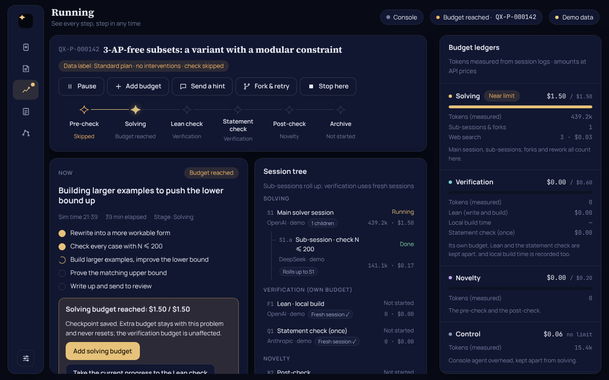

[中文](README.md) · **English**

# Qunxing desktop app · qunxing-app

Explore open math problems on your own computer, with the AI subscription you already have. Proofs are checked in Lean, and verifiable results light a star on the Qunxing star map.

## Download

> **The beta isn’t out yet.** The links below will work once the first version is released. To hear about it first, click **Watch → Custom → Releases** at the top right of this page.

- **[Download for Windows (installer)](https://github.com/qunxingmath-org/qunxing-app/releases/latest/download/Qunxing-Setup.exe)**
  - Installs for the current user; no administrator rights needed.
- [Full package (zip, no install)](https://github.com/qunxingmath-org/qunxing-app/releases/latest/download/Qunxing-Windows-x64.zip)
  - Unzip anywhere and double-click `Qunxing.exe`.
- [Download page on the website](https://www.qunxingmath.org/en/download/)
  - The same files, plus a mirror in mainland China and the SHA-256 of each file.
- [All versions and release notes](https://github.com/qunxingmath-org/qunxing-app/releases)

Windows only for now; a macOS version is in progress.



## What you need

- Windows 10 or 11, 64-bit.
- At least one AI coding tool, signed in: Codex CLI, Claude Code or Gemini CLI. A subscription or an API key both work.
- Lean 4 is optional: you need it only for the Lean check. The setup guide shows how to install it.
- Internet access for drawing problems, bank updates, novelty checks and AI calls. You can also run locally only.

## Get started in three steps

1. **Install.** Run the installer, or unzip the full package anywhere and double-click `Qunxing.exe`.
2. **First launch.** The setup guide walks you through:
   - picking a work folder, where run records and proofs are stored;
   - finding the Codex CLI, Claude Code or Gemini CLI already on your computer, connecting one as your console, and assigning agents for solving, verification and novelty checks;
   - setting a daily spending cap, and watching a free demo run.
3. **Draw a problem and run it.** Draw an open problem from the bank, check whether it is still open, then let the AI work on it.
   - While it runs, you can pause, add budget, send a hint, fork a retry or stop here;
   - actions that need your approval pop up in a small window on top;
   - results that pass both the Lean check and the statement check light a star on the star map.

For every step in detail, see the [user guide](docs/guide/en/README.md).

## FAQ

**Windows says “Windows protected your PC”. What should I do?**

This happens while the app isn’t code-signed yet. Make sure you downloaded the file from this repository’s releases or the Qunxing website, then click “More info” and “Run anyway”.

To verify the file, open PowerShell in your download folder and run:

```powershell
Get-FileHash .\Qunxing-Setup.exe -Algorithm SHA256
```

The result should match `SHA256SUMS.txt` in the release.

**The setup guide can’t find my agent.**

1. First check that it works in a terminal: run `codex`, `claude` or `gemini`; it should answer and be signed in.
2. Then click “Search again” in the setup guide.

Codex CLI and Claude Code also need a small bridge program (an ACP adapter). Qunxing offers to install it and asks you first. Gemini CLI doesn’t need one.

**Do I have to install Lean?**

No. You can solve problems and keep records without it. You need Lean only to pass the Lean check and light a star.

The setup guide has installation steps; the Mathlib cache downloads automatically on the first check.

**How much does it cost?**

Qunxing itself is free. AI costs follow your own subscription or API usage:

- before each run you set separate budgets for solving and verification, and the run stops to ask you when a budget runs out;
- there is also a daily spending cap;
- costs are kept in five ledgers that you can see on the run page at any time.

**Where is my data?**

Everything is in the work folder you chose, one folder per run, with the run record, proofs, Lean files and novelty reports. Settings shows the location, and the result page has “Show in folder”.

**How do I uninstall?**

- Installer version: Windows Settings → Apps → Qunxing → Uninstall.
- Zip version: delete the unzipped folder.

Uninstalling doesn’t delete the run records in your work folder. Delete them yourself if you don’t need them.

**Can I use it offline?**

Turn on “Run locally only” in Settings: Qunxing then takes no updates, uploads nothing, and draws problems from the local bank snapshot. Calling an AI still needs the internet, because the AI tools themselves do.

More questions are answered in the guide's [FAQ](docs/guide/en/faq.md).

## Privacy

- Nothing is uploaded by default. Run records, proofs and costs stay on your computer.
- To submit a result to Qunxing, you press “Upload to Qunxing” yourself. It has two steps, submitting the proof and uploading research data, each with its own consent. The beta can't upload yet; both steps arrive when uploads open.
- Qunxing doesn’t collect conversation text, prompts, files or paths on your computer, accounts or API keys. The details will be in the Qunxing research code, published with the website.

## Contributing

- When the beta is released, the code will move to this repository and be built in public CI.
- See [CONTRIBUTING.md](CONTRIBUTING.md). Every commit needs a sign-off (`git commit -s`).
- Please report problems and ideas as issues. Report security issues privately as described in [SECURITY.md](SECURITY.md).

## License

- Code: [MIT](LICENSE).
- The Qunxing name and logo are not covered by the MIT license; see [TRADEMARKS.md](TRADEMARKS.md).
- Website: <https://www.qunxingmath.org>
