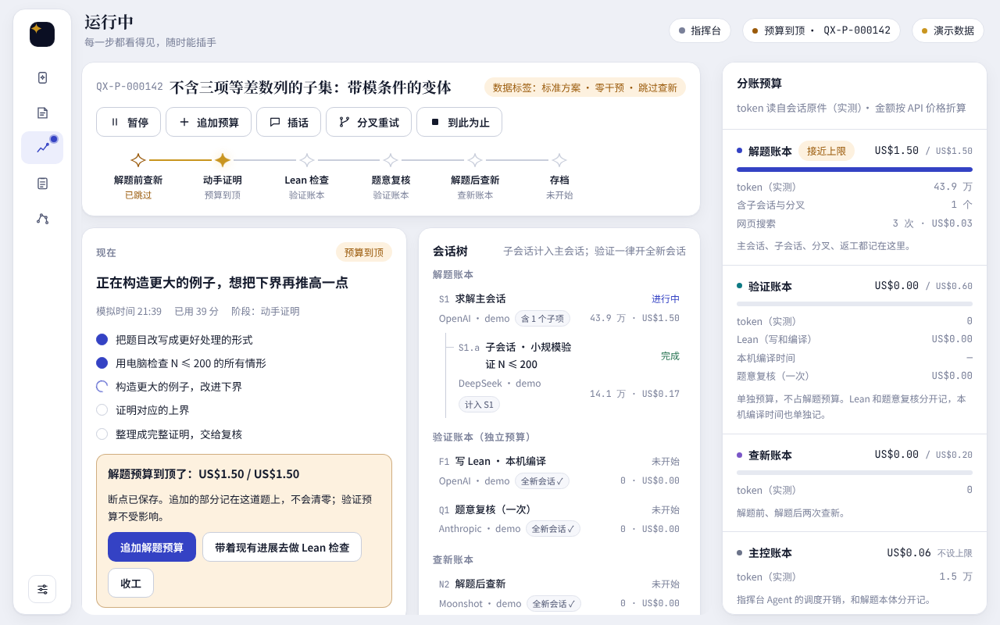

**中文** · [English](README.en.md)

# 群星桌面端 · qunxing-app

在自己的电脑上，用你已有的 AI 订阅探索开放数学问题。证明用 Lean 检查，可以验证的结果会在群星的星图上点亮一颗星。

## 下载

> **测试版还没发布。** 第一个版本发出后，下面的链接就能用。想第一时间知道：点本页右上角的 **Watch → Custom → Releases**。

- **[下载 Windows 版（安装包）](https://github.com/qunxingmath-org/qunxing-app/releases/latest/download/Qunxing-Setup.exe)**
  - 装在当前用户目录下，不需要管理员权限。
- [完整应用包（免安装 zip）](https://github.com/qunxingmath-org/qunxing-app/releases/latest/download/Qunxing-Windows-x64.zip)
  - 解压到任意文件夹，双击 `Qunxing.exe`。
- [网站下载页](https://www.qunxingmath.org/download/)
  - 同样的文件，另有国内镜像，并列出每个文件的 SHA-256。
- [所有版本和版本说明](https://github.com/qunxingmath-org/qunxing-app/releases)

目前只有 Windows 版，macOS 版在做。



## 需要什么

- Windows 10 或 11，64 位。
- 至少一个会写代码的 AI 工具，并且已经登录：Codex CLI、Claude Code 或 Gemini CLI。用订阅或 API 都行。
- Lean 4 是可选的：要让结果过 Lean 核对才需要。新手引导里会教怎么装。
- 联网：抽题、更新题库、查新和调用 AI 时要联网。也可以设成只在本机运行。

## 三步上手

1. **安装。** 运行安装包；或者把完整应用包解压到任意文件夹，双击 `Qunxing.exe`。
2. **第一次打开。** 新手引导会带你做这几件事：
   - 选好工作文件夹，运行记录和证明都存在这里；
   - 找到电脑上已经装好的 Codex CLI、Claude Code 或 Gemini CLI，连上一个当"指挥台"，再给解题、验证、查新分配 Agent；
   - 设每日花费上限，看一次不花钱的演示运行。
3. **抽一道题，开跑。** 从题库抽一道开放问题，先查新，再让 AI 解题。
   - 运行中随时可以暂停、追加预算、插话、分叉重试、到此为止；
   - 需要你批准的操作，会弹出一个在最前面的小窗口；
   - Lean 核对和题意复核都通过的结果，会在星图上点亮。

## 常见问题

**Windows 提示"Windows 已保护你的电脑"，怎么办？**

程序还没有代码签名时会这样。确认文件是从本仓库的 Release 或群星网站下载的，然后点"更多信息"，再点"仍要运行"。

想核对文件，在下载文件夹里打开 PowerShell，运行：

```powershell
Get-FileHash .\Qunxing-Setup.exe -Algorithm SHA256
```

结果应和 Release 里的 `SHA256SUMS.txt` 一致。

**新手引导找不到我的 Agent？**

1. 先在终端里确认它能用：运行 `codex`、`claude` 或 `gemini`，能正常对话，并且已经登录。
2. 然后在新手引导里点"重新查找"。

Codex CLI 和 Claude Code 还需要一个小的转接程序（ACP 适配器）。群星会提示你安装，装之前会先问你；Gemini CLI 不需要。

**一定要装 Lean 吗？**

不用。不装 Lean 也能解题、留下记录。要让结果过 Lean 核对、在星图上点亮，才需要 Lean。

新手引导里有安装说明；Mathlib 缓存会在第一次核对时自动下载。

**会花多少钱？**

群星本身免费。AI 的花费按你自己的订阅或 API 计算：

- 每道题开跑前，分别设解题和验证的预算，到顶会停下来问你；
- 另外有每日花费上限；
- 花费分五本账记，运行页上随时能看。

**我的数据存在哪里？**

都在你选的工作文件夹里，每次运行一个文件夹，里面有运行记录、证明、Lean 文件和查新报告。设置里能看到位置；结果页也有"在文件夹中显示"。

**怎么卸载？**

- 安装版：Windows 设置 → 应用 → 群星 → 卸载。
- 免安装版：删掉解压出来的文件夹。

卸载不会删除工作文件夹里的运行记录。不需要的话，请自己删除。

**能不联网用吗？**

设置里打开"只在本地运行"，群星就不收更新、不上传，抽题用本机的题库快照。但调用 AI 仍然要联网，因为 AI 工具本身要联网。

## 隐私

- 默认不上传任何东西。运行记录、证明和花费都留在你的电脑上。
- 想把结果提交到群星，要你自己点"上传到群星"。分两步：提交证明、上传科研数据，每步单独同意。
- 不收集对话原文、提示词、你电脑上的文件和路径、账号和 API 密钥。细节见《群星研究守则》，会和网站一起发布。

## 参与开发

- 测试版发布时，代码会放到这个仓库，用公开的 CI 构建。
- 参与方式见 [CONTRIBUTING.md](CONTRIBUTING.md)。每个提交都要签名（`git commit -s`）。
- 问题和建议请开 Issue。安全问题请按 [SECURITY.md](SECURITY.md) 私下报告。

## 许可

- 代码：[MIT](LICENSE)。
- "群星"的名称和标志不在 MIT 许可之内，见 [TRADEMARKS.md](TRADEMARKS.md)。
- 网站：<https://www.qunxingmath.org>
