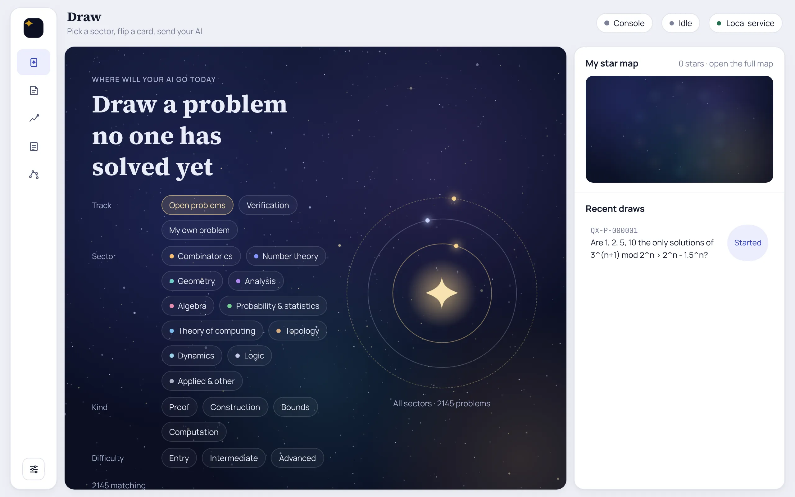
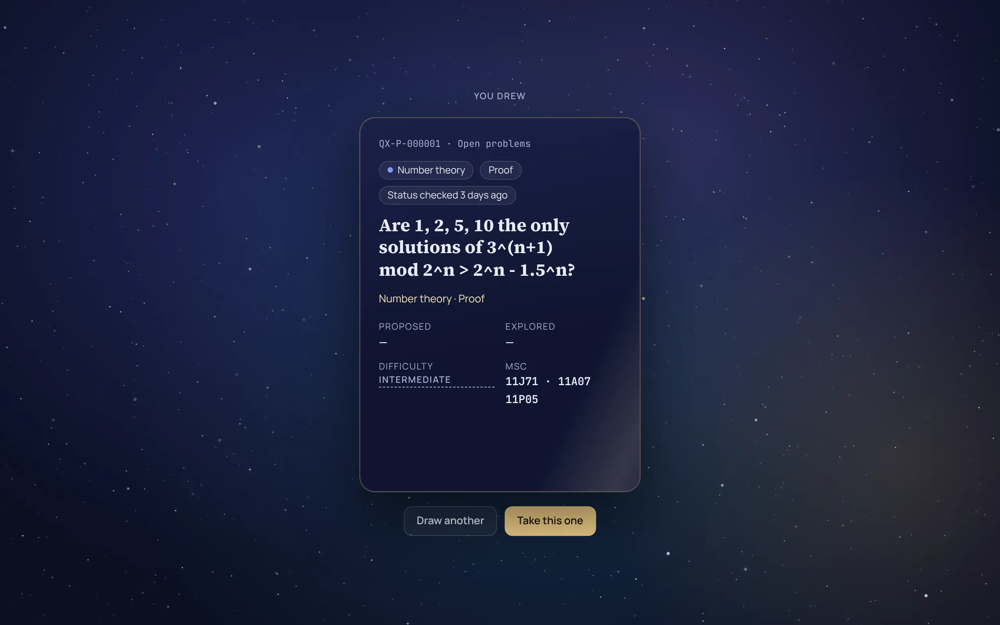
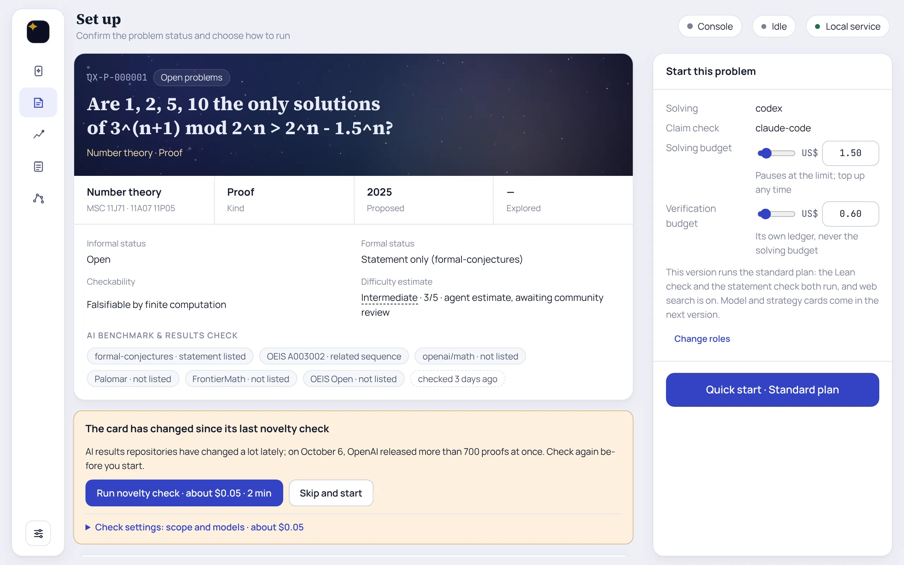
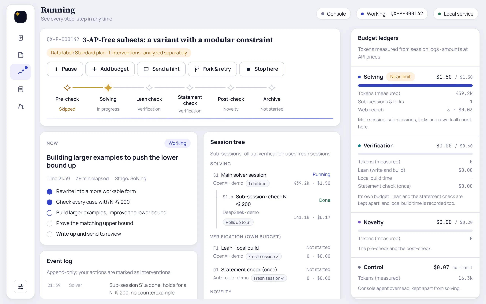
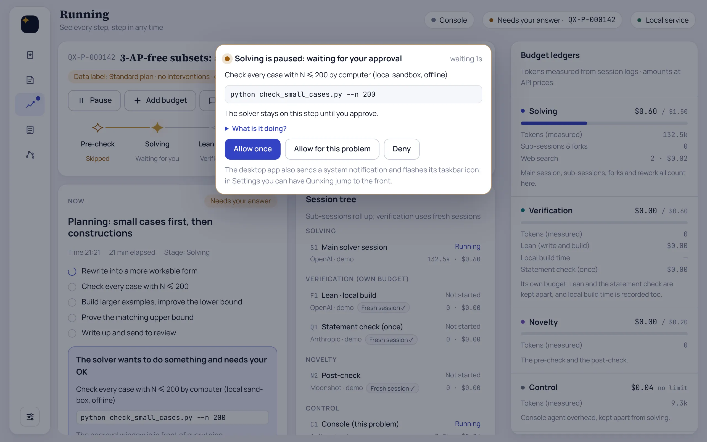
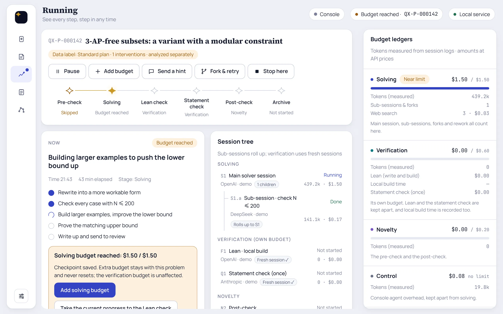
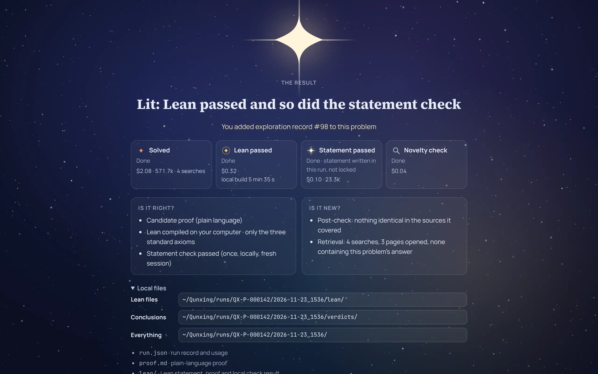
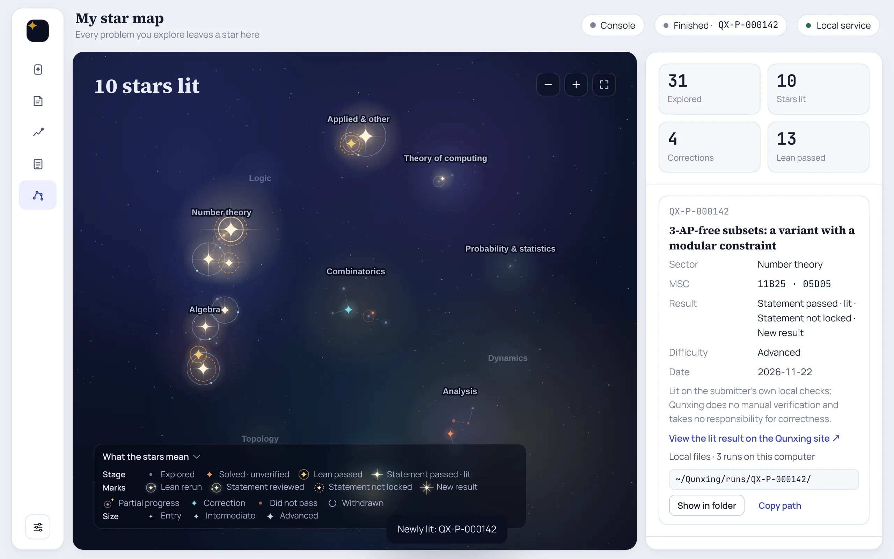

[Contents](README.md) · **Your first problem** · [中文](../zh/first-problem.md)

# Your first problem

A problem goes through five screens on its way to a lit star: Draw → Set up → Running → Result → Star map.

## 1. Draw

Choose filters on the left. Leave a group empty to allow any value.

| Filter | Options |
|---|---|
| Track | **Open problems**: nobody has solved them yet. A solution is a new result, so the novelty check comes first. **Verification**: already solved. Formalize the known proof in Lean to confirm it. **My own problem**: a problem you bring yourself. Coming in a later version. |
| Sector | Combinatorics, Number theory, Geometry, Analysis, Algebra, Probability & statistics, Theory of computing, Topology, Dynamics, Logic, Applied & other |
| Kind | Proof, Construction, Bounds, Computation |
| Difficulty | **Entry**: finite computation, special cases or small extensions; a good first run. **Intermediate**: a research-level open problem, usually with partial progress. **Advanced**: open for 20+ years; a solution would be major news in the field. |

- The page shows how many problems match.
- Click **Draw a problem**, or click the star gate.

The card shows the problem ID, sector, kind and statement.
- Not this one: **Draw another**.
- This one: **Take this one**.

**For your first run, pick Entry.** It costs less, finishes sooner, and you get to see the whole flow.

## 2. Set up

### The card

**The middle shows what is known about the problem**:
- informal and formal status;
- checkability and a difficulty estimate;
- **AI benchmark & results check**: whether public problem banks and AI results repositories list this problem, and whether a proof is known.

### The novelty check

The "open" status of a problem can go stale: AI has produced many new results lately.

**Qunxing reminds you when the status is old**, for example when:
- the last check was several days ago;
- the card has changed since it was checked;
- the problem has never been checked.

**You have two choices**:
- **Run novelty check**: the button shows the estimated cost and time.
  - The novelty check runs first; solving starts after it.
  - Novelty checks have their own ledger and never use the solving budget.
- **Skip and start**: tick the confirmation, then click **Confirm and start**.
  - By confirming, you accept that if the problem turns out to be solved already, the cost and conclusions are your responsibility.
  - Qunxing records that you skipped the check.

### Roles and budgets

**The right side shows the roles and budgets for this run**:
- **Roles**: who solves and who checks. You assign them in the setup guide's "Who solves" step; **Change roles** takes you back there.
- **Solving budget**: pauses at the limit; top up any time.
- **Verification budget**: its own ledger, never the solving budget.

**This version runs the standard plan**:
- the Lean check and the statement check both run;
- web search is on;
- model and strategy cards come in the next version.

Click **Quick start · Standard plan**.

**If the problem bank is old**, you're asked to update it first:
- **Update the bank**;
- or **Open anyway**.

## 3. Running

### Top: where the run is

**The stage path**: Pre-check → Solving → Lean check → Statement check → Post-check → Archive.

**The data label next to the title**, for example "Standard plan · 1 intervention · analyzed separately".
- Runs you stepped into are marked, and statistics compare them separately.

### The action buttons

| Button | What it does |
|---|---|
| **Pause** / **Resume** | Stop or continue |
| **Add budget** | Add money to solving or verification. The top-up stays with this problem and never resets; the run is labeled "budget changed · intervention" |
| **Send a hint** | Give the solver one hint, such as "try classifying by residues mod 3". The run is marked human-assisted and analyzed in its own stratum. Reviewers never see your hint |
| **Fork & retry** | The main line keeps running; a copy starts from the current checkpoint and tries another approach |
| **Stop here** | Finished steps are kept and you can continue from here later; the run is recorded as stopped by you |

### Middle: Now, session tree, event log

- **Now**: what the AI is doing right now, and its plan, ticked off item by item.
- **Session tree**: the main session, sub-sessions and forks.
  - Sub-session usage rolls up to the main session.
  - The Lean check and the statement check each start a fresh session and can't see how the problem was solved.
- **Event log**: every step is recorded. Entries are only appended, never changed. Your actions are marked as interventions.

### Right: the budget ledgers

**Costs go into four ledgers**:

| Ledger | What it records |
|---|---|
| Solving | Main session, sub-sessions, forks, web searches |
| Verification | Writing Lean, local builds, the statement check |
| Novelty | The checks before and after solving |
| Control | Overhead of the console agent |

**Token counts say where they come from**:
- **measured**: read from the agent's own logs;
- **reported by the agent**: not verified;
- **estimated**.

**Amounts are converted at API prices.** On a subscription you pay nothing extra; the amount is for reference.

### The AI asks before it acts

**When the solver wants to run a program or write a file, a small window comes to the front.** It says what the solver wants to do, and why.

Three buttons:
- **Allow once**;
- **Allow for this problem**;
- **Deny**.

**While it waits for you**:
- the solver stays on this step and the clock stops;
- your choice goes into the event log.

**If Qunxing is in the background**:
- it sends a system notification and flashes its taskbar icon;
- to have the window jump to the front: Settings → **Bring Qunxing to the front when it needs my approval**.

**How often the AI asks** is set in Settings → **Run mode**:
- **Fully automatic**;
- **Ask at key steps**;
- **Ask every step**.

### Budget reached

When the solving budget runs out, the run pauses with a saved checkpoint. Three choices:
- **Add solving budget**: drag or type an amount and keep going.
- **Take the current progress to the Lean check**: stop solving and send what exists to be checked.
- **Wrap up**: end here; the work and failure paths are archived.

**When a subscription quota runs out**, Qunxing waits until the quota resets and then continues by itself. The waiting time isn't counted.

## 4. Result

When the run ends, the result page opens.

**The headline says how far the run got**, for example:
- nothing checkable this time; the work and failure paths are saved;
- a candidate proof, not yet verified;
- Lean passed; the statement hasn't been checked yet;
- **Lit: Lean passed and so did the statement check**.

**Four tiles**: Solved, Lean passed, Statement passed, Novelty check.
- Each tile shows its state: done, stopped here, or not done.
- Each tile shows its cost.
- The novelty tile also shows the number of searches.

**Is it right?**
- the candidate proof in plain language;
- whether Lean compiled on your computer, using only the three standard axioms;
- whether the statement check passed.

**Is it new?**
- the conclusion of the post-check;
- retrieval: how many searches, how many pages opened, and whether any of them contained this problem's answer.
  - If a source with the answer was opened, a success counts as "retrieved".

**Local files**: where the Lean files, conclusions and all materials are.
- **Show in folder** opens the folder.

**The buttons underneath**:
- **Draw another**;
- **See it on the star map**;
- **Continue**: if you stopped early, pick up from where you stopped.

**There are also two upload buttons**: **Upload research data** and **Submit the proof, light the star**.
- This version can't upload yet: clicking them only says it isn't wired up yet, and nothing is sent.
- How they will work: [Privacy and uploads](privacy-and-uploads.md).

**Lighting rests on the checks done on your computer.** Qunxing does no manual verification and takes no responsibility for the result.

## 5. Star map

Every problem you explore leaves a star here.
- Drag to pan, scroll or pinch to zoom, double-click to fit.
- **What the stars mean**, at the bottom left, is the legend.

**Stages of a star**:

| Stage | Meaning |
|---|---|
| Explored | Run, but nothing checkable yet |
| Solved · unverified | The agent handed in a proof; Lean hasn't checked it |
| Lean passed | Lean compiled it on your computer using only standard axioms; the statement hasn't been checked |
| Statement passed · lit | Lean passed, and a check confirmed the Lean statement is the original problem |

**A star can also carry marks**:
- **Lean rerun**: Qunxing reran Lean in public CI, and it passed;
- **New result**: lit, and the novelty check found no earlier result in the sources it covered;
- **Statement reviewed**: a maintainer has reviewed and locked the card's Lean statement;
- **Statement not locked**: Lean proved a statement written in this run that no maintainer has locked yet; not counted as solved on the site;
- **Partial progress**: a special case, bound or lemma;
- **Correction**: listed as open, but already solved in the literature;
- **Did not pass**: Lean or the statement check failed; the record stays.

**Click a star to see its details on the right**:
- sector, MSC code, result, difficulty and date;
- its files on this computer;
- a link to the problem on the Qunxing website.

Next: [Lean](lean.md)
