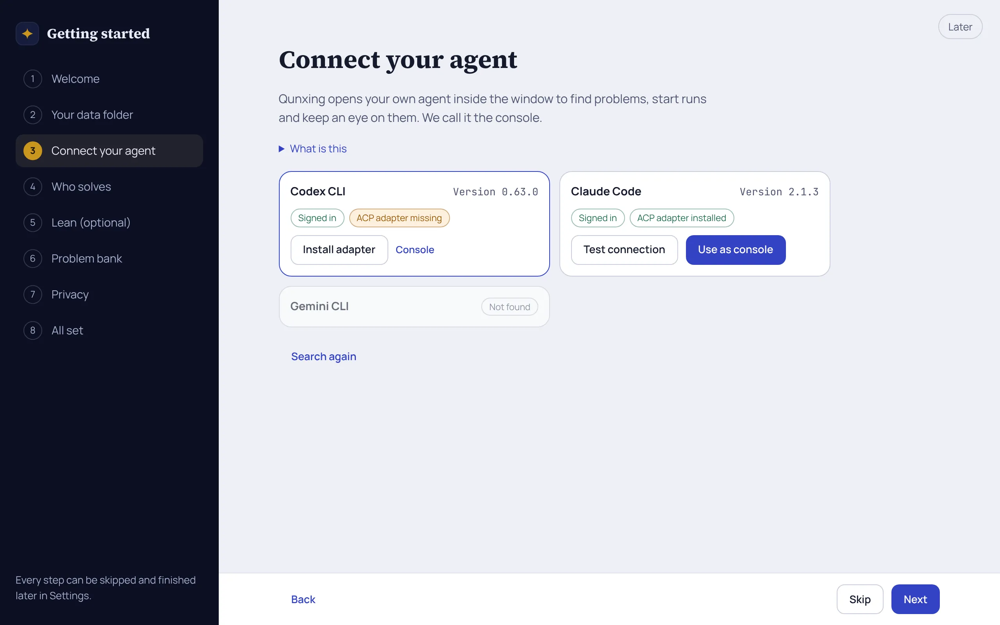

[Contents](README.md) · **First launch** · [中文](../zh/first-run.md)

# First launch: the setup guide

The first time you open Qunxing, a setup guide walks you through eight steps.
- You can **Skip** any step and finish it later in Settings.
- To start over: Settings → **Run setup again**.

## 1. Welcome

Pick a language (中文 or English) and a theme. You can change both in Settings at any time.

## 2. Your data folder

Problem cards, run records, proofs and Lean files are stored in this folder on your computer.
- The default is `C:\Users\<your user name>\Qunxing`.
- To use another one, click **Choose another folder**. You can also change it later in Settings; existing files move with it.
- Nothing is uploaded by default.

## 3. Connect your agent

Qunxing looks for the AI coding tools (agents) already installed on your computer: Codex CLI, Claude Code and Gemini CLI.

**Each card shows**:
- the version;
- the sign-in state: **Signed in**, **Signed out** or **Sign-in unknown**;
- how it connects:
  - **Native ACP**: works directly (Gemini CLI);
  - **ACP adapter installed**;
  - **ACP adapter missing**: Codex CLI and Claude Code need a small bridge program.

**The buttons on a card**:
- **Install adapter**: first shows what will be downloaded and how big it is. Nothing is installed until you click **Install**.
  - The adapter comes from npm and goes into Qunxing's own folder. Your global settings stay unchanged.
- **Test connection**: sends one short message, then closes the session.
  - On a subscription this uses a little quota; on an API key it costs about $0.001.
  - On success you see the round-trip time and whether metering found this call.
- **Use as console**: the console is your own agent, running inside the Qunxing window. It can find problems, start runs and keep an eye on them for you.
  - It can use Qunxing's features, but any public submission needs your own confirmation.

**Nothing found?**
1. Install one following its official instructions, and sign in from a terminal. When nothing is found, this step lists the official install pages.
2. Come back and click **Search again**.
3. Still nothing? See the [FAQ](faq.md#the-setup-guide-cant-find-my-agent).

To skip this for now, click **Just look around**.

## 4. Who solves

Pick an agent for each part of the work:

| Role | What it does |
|---|---|
| Solve | Works on the proof |
| Write Lean | Writes the proof in Lean and compiles it on your computer |
| Statement check | In a fresh session, checks that the Lean statement is the original problem |
| Novelty · search | Looks for whether someone has already solved the problem |
| Novelty · judge | When there's a likely hit, opens the sources and decides |

**Two tips**:
- **Use a different vendor for the check** if you can; it's more trustworthy. One vendor also works: the check always starts a fresh session.
- **Each role can use a subscription or an API key**:
  - Subscription: uses your plan's quota at no extra charge, and waits when the quota runs out.
  - API: pay per use; every charge goes into the ledgers.

**Reset to standard** puts back the default assignment.

This step also sets the **Daily spending cap**.
- At the cap, no new runs start;
- runs in progress pause and ask you.

## 5. Lean (optional)

Click **Check** to look for Lean on your computer.
- **Found**: you see the elan and Lean versions.
- **Not found**: you see the install steps. You can also click **Install later**.
  - Without Lean you can still solve, but runs stop at "Solved" and can't reach "Lean passed".
  - Details: [Lean](lean.md).

## 6. Problem bank

**Shows**: the date of your problem bank and how many problems it has.

**Click Update now.** Cards may have been revised, and problems may have been solved since.
- The new bank is checked before it's used; if the check fails, the old one stays.

**When updates arrive**, pick one:
- **Update automatically**;
- **Ask me first** (the default);
- **Don't receive**.

**Local only**: no updates and no uploads. The AI tools still need the internet.

## 7. Privacy

Nothing is uploaded by default. When you want to share a result, Qunxing asks in two separate steps:

| Step | What is sent | Public? |
|---|---|---|
| Submit the proof, light the star | Only the proof materials | Public; needs a GitHub sign-in to link an account |
| Upload research data | Only usage and cost | Anonymous; no proofs, transcripts or prompts |

You can skip either step and turn uploads off any time in Settings. Details: [Privacy and uploads](privacy-and-uploads.md).

## 8. All set

Here you see where each item stands:
- **Ready**, **Worth a look**, **To do**, **Not installed** or **Error**;
- anything unfinished can be done later in Settings.

Then choose:
- **Watch a demo run (free)**: the full flow on demo data. The agent is a script, and Lean and the costs are simulated.
- **Draw a problem**: see [Your first problem](first-problem.md).

## The small labels at the top right

- **Console**: opens the chat with your agent.
- **Status**: Idle, Working, Paused, Needs your answer, Budget reached or Finished.
- **Local service**: the window is connected to Qunxing's background service.
  - **Reconnecting…**: the event stream dropped. It reconnects by itself and catches up on missed events.
  - **Connection expired**: close the window and reopen Qunxing.

Next: [Your first problem](first-problem.md)
