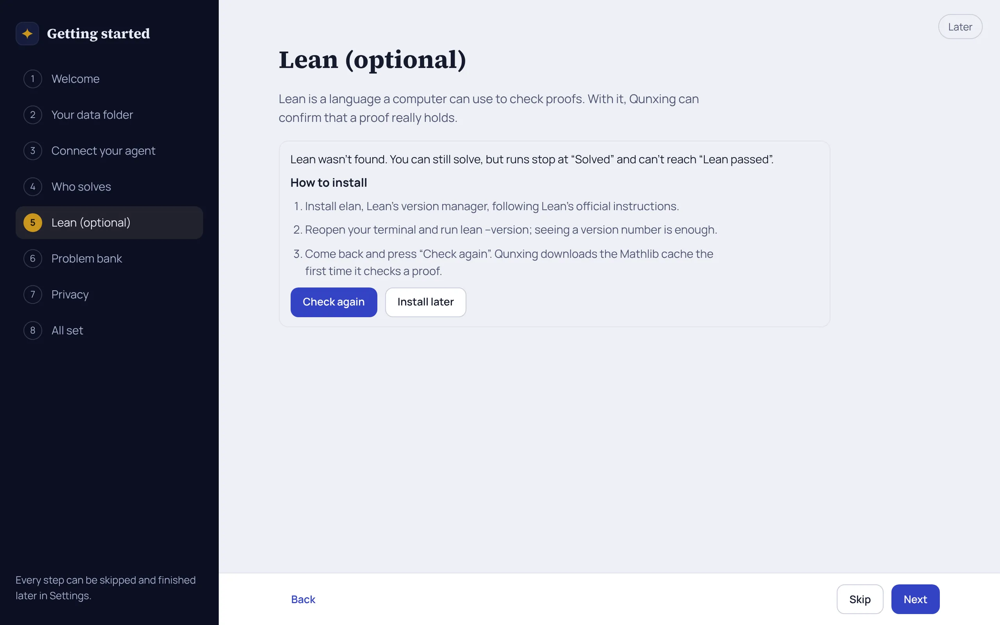

[Contents](README.md) · **Lean** · [中文](../zh/lean.md)

# Lean

## What Lean is and why to install it

Lean is a language a computer can use to check proofs. A plain-language proof written by an AI can have gaps; a proof that Lean has checked is far more reliable.

**Qunxing uses Lean for two things**:
1. **The Lean check**: the agent assigned to write Lean turns the proof into Lean and compiles it on your computer.
   - It counts as "Lean passed" only if it compiles and uses only the three standard axioms.
2. **The statement check**: another agent, in a fresh session, checks that the statement written in Lean is the original problem.
   - This catches "proved an easier problem".

A star on the map is lit only when both pass.

**You can use Qunxing without Lean**: you can still solve problems and keep run records, but results stop at "Solved" and can't reach "Lean passed".

## Check whether Lean is installed

- In the setup guide's **Lean (optional)** step, click **Check**;
- or run the setup guide again from Settings and go to that step.



If Lean is found, you see the elan and Lean versions and whether the Mathlib cache is available.

## Install

**The setup guide gives the exact commands for your system**; follow them. On Windows it usually goes like this:

1. **Install elan**, Lean's version manager. It installs the Lean versions that are needed.
   - Open Command Prompt, or PowerShell 7.4.1 or later, and run:

```powershell
curl -O --location https://elan.lean-lang.org/elan-init.ps1
powershell -ExecutionPolicy Bypass -f elan-init.ps1
del elan-init.ps1
```

2. **Close the terminal and open a new one**, then run:

```powershell
lean --version
```

   If you see a version number, Lean is installed.

3. **Go back to Qunxing and click Check again.**

elan's official instructions are the reference: <https://github.com/leanprover/elan>

## The first check is slow

- The first Lean check downloads the Mathlib cache. Mathlib is Lean's mathematics library, and its cache is large.
- Later checks are much faster.
- Build time and peak memory are recorded in the verification ledger on the run page.

## Lean on the result page

The "Is it right?" part of the result page says exactly what happened:

| It says | Meaning |
|---|---|
| Lean compiled on your computer · only the standard axioms | Passed |
| Lean compiled, but used axioms beyond the standard ones | Not a pass; the extra axioms are listed |
| Lean didn't pass | The build failed. The failed attempt is kept |

Under "Local files" on the result page you can find the Lean project folder.

## Locked statements

**Some problems in the Qunxing bank have a Lean statement that a maintainer has reviewed and locked**:
- when a run uses the locked statement, the statement check can reuse the card's existing check.

**For problems without a locked statement**:
- Lean proves a statement written during the run;
- the star carries the "Statement not locked" mark;
- the website doesn't count it as solved until a maintainer locks the statement.

Next: [Research plans](research-plans.md)
