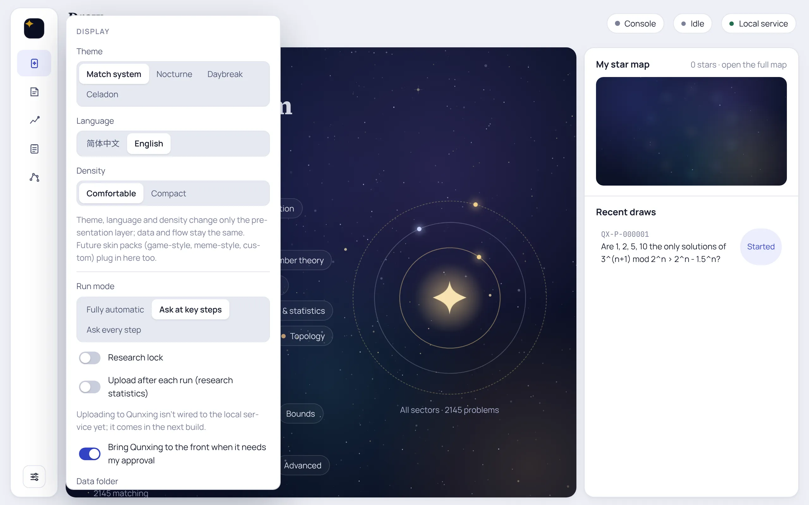

[Contents](README.md) · **Privacy and uploads** · [中文](../zh/privacy-and-uploads.md)

# Privacy and uploads

## Nothing is uploaded by default

Run records, proofs, Lean files and costs stay in the data folder on your computer. See [Uninstall and where your data lives](uninstall.md).

**Qunxing does not collect**:
- conversation transcripts or prompts;
- files or paths on your computer;
- accounts or API keys.

**There are no analytics and no automatic crash reports.**

## When Qunxing goes online

| What | When | What is sent | How to turn it off |
|---|---|---|---|
| Check for problem-bank updates | Once at startup, then at most every 6 hours | Only a request for the latest bank version on GitHub; nothing is downloaded and none of your data is sent | Settings → Updates and network → Don't receive; or turn on "Run locally only" |
| Check for app updates | Together with the above | Only whether there is a new version | Same |
| Download updates | By default only after you agree | Downloads only | Same |
| Call the AI | After you start a run | The problem, the prompts, and what the AI reads in the problem's folder. **Your own** AI tool sends them to its provider | Don't start a run |
| Novelty check | The first step of a run; can be skipped | Search terms, also sent by your AI tool | Choose "Skip and start" when setting up |
| Upload results | Only when you click | See "Uploads" below | Don't click |

**Two notes**:
- Whenever Qunxing goes online, the other side can see your IP address.
- How an AI provider handles your data is between you and that provider. Qunxing can't control it and doesn't see it.

## Run locally only

Settings → **Updates and network** → turn on **Run locally only (never contact Qunxing's servers)**. Then:
- no updates and no uploads;
- the problem bank stays as it is, and setting up a problem reminds you that it won't update;
- solving still uses your own AI accounts, so that part still needs the internet.

## Uploads

> **This version can't upload yet.** The upload buttons on the result page only say they aren't wired up yet, and nothing is sent. The rest of this section describes how uploads will work once they open.

Uploading has two steps. Each one asks for your consent separately, and you can skip either.

### Step 1: submit the proof, light the star

- **What is sent**: the proof materials for the stage the run reached:
  - the proof in plain language;
  - the Lean project;
  - the local check parameters: toolchain and Mathlib versions, file hashes, axioms used;
  - the statement-check record.
- **Public?** Yes. Lean code is licensed under Apache-2.0 and text under CC BY-SA 4.0. Once public, it can be withdrawn but not deleted.
- **Not sent**: usage and cost, which are step 2; no conversation transcripts.
- **What you need**: a Qunxing account, linked by signing in with GitHub.
  - Open github.com/login/device in your browser and enter the code Qunxing shows.
  - Qunxing reads only your GitHub user ID and asks for no repository access.
  - The account is used only for accountability and withdrawals, and isn't shown publicly.
- **Where it goes**: the Qunxing public dataset, your own GitHub repository, or both.
  - For your own repository, you install Qunxing on that one repository on GitHub. Qunxing can write only to that repository.
- **Afterwards**: Qunxing reruns Lean in public CI. When it passes, the star gets the "Lean rerun" mark.

### Step 2: upload research data

Only usage and cost, anonymously. It's used to study how much compute AI needs for math problems, and how well it works.

**What is uploaded**:
- usage: tokens and time for each step, and the cost at API prices;
- how it ran:
  - models and tool versions, and the budget caps of each ledger;
  - the number of web searches;
  - which kinds of intervention you made (types and counts only);
- the result:
  - the problem ID and the step where the run stopped;
  - your own answers to "Is it right?" and "Is it new?";
  - retrieval statistics;
- an install ID (random, created on your computer, resettable in Settings), the run time (to the minute) and the channel (subscription or API).

**Never uploaded**:
- the proof itself (that's step 1, submitted separately);
- conversation transcripts or prompts;
- files and paths on your computer, or machine details;
- accounts or API keys.

**Three choices**: **Just this once**, **Always upload**, **Not now**.
- With "Always upload", you still get a notice after each upload.
- You can turn automatic uploads off in Settings at any time.
- Automatic uploads send usage only; they never submit a proof for you.

**Our commitments**:
- Used only for research statistics; never for advertising, never sold.
- Public data is released two weeks late, with dates rounded to the week; groups with too few records are merged first.
- You can stop uploading or ask for deletion at any time.
- If what we upload changes, we ask for your consent again.

The consent screen states where the data is stored, who receives it and how long it is kept. The full rules are in the Qunxing Research Code, which will be published with the website.

Next: [FAQ](faq.md)
