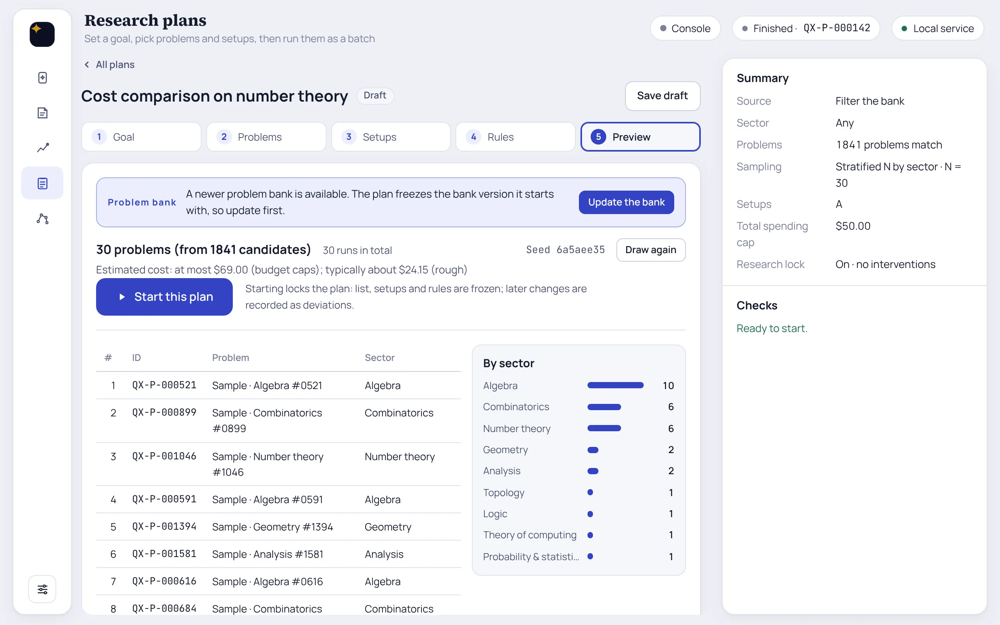

[Contents](README.md) · **Research plans** · [中文](../zh/research-plans.md)

# Research plans

A research plan runs a batch of problems. For example: how much do two setups cost on number-theory problems, and how often do they succeed?

Click **Plans** in the left bar.

## Create a plan

Click **New plan** and fill in five steps.

### 1. Goal

- **Title**: for example "Cost comparison on number theory".
- **Goal**: what you want to learn from this batch.

### 2. Problems

**Source**, one of:
- **Filter the bank**:
  - by sector, track, difficulty and status. Leave a group empty to allow any value.
  - You can take a sample instead of every match, stratified by sector.
  - The sample uses a random seed; **Draw again** picks another. The list you preview is the list that runs.
- **Imported IDs**: one problem ID per line, or comma-separated, such as `QX-P-000142`.
- **Both**.

**Order**: as listed, random, or **interleave by share**.
- Interleaving keeps every prefix of the run order proportional across sectors, so wherever the plan stops, the finished part matches the list's mix.

### 3. Setups

**A setup is one way of running**:
- which agent solves and which one checks;
- the budgets;
- whether to run the statement check.

**To compare two ways of running**, click **Add a setup**. **Assignment** decides how setups map to problems:
- **Every setup on every problem (paired)**: the fairest comparison;
- **Round robin**: costs less.

### 4. Rules

- **Stop when any is reached**:
  - a total spending cap;
  - an end date;
  - a maximum number of runs.
- **When the subscription quota runs out**: wait for it, or stop.
- **Concurrency**: one problem at a time, for more accurate metering.
- **Research lock (no interventions)**:
  - no budget top-ups, hints or forks during runs;
  - permission requests are answered by the policy you choose;
  - use it for batches you want to compare, so every run has the same conditions.

### 5. Preview

The preview lists:
- the problems;
- the estimated cost;
- the mix by sector;
- anything to fix first.

If everything looks right, click **Start this plan**.

## After you start

**Starting locks the plan**: the list, setups and rules are frozen.
- To change something afterwards, record it under **Deviations**: what changed and why.
- The export then shows which runs followed the original plan.

**The plan freezes the problem-bank version it starts with.**
- If a newer bank is available, you're asked to update before starting.

**While it runs**:
- the progress table shows each problem's state: queued, running or done;
- you can **Pause**, **Resume** or **Stop plan**.
  - Stopping needs a second click to confirm.

## Import and export

**Import**: click **Import** and paste either:
- a plan JSON in the `qunxing.plan/1` format;
- a list of problem IDs.

**Export**:
- **Plan and results (JSON)**;
- **Per-run results (CSV)**, which opens in any spreadsheet app.

## Research plugins

Research plugins add extra metering and exports.
- They aren't part of the public release and can only be installed in **Developer mode**.
- Before installing, Qunxing lists the permissions a plugin asks for.

Next: [Privacy and uploads](privacy-and-uploads.md)
