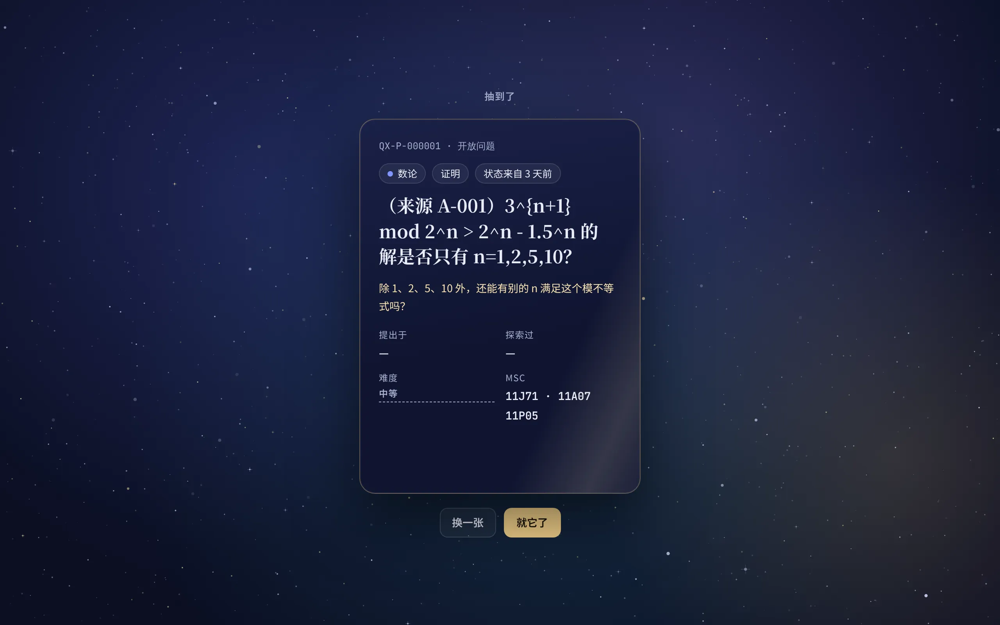
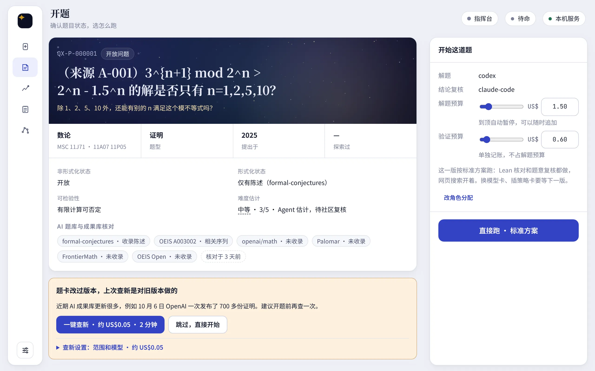
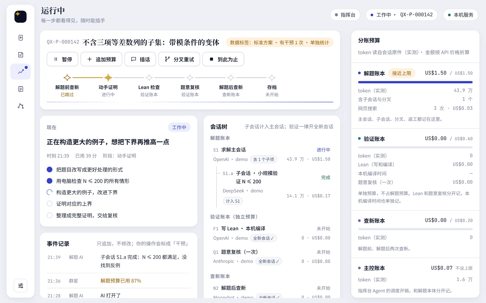
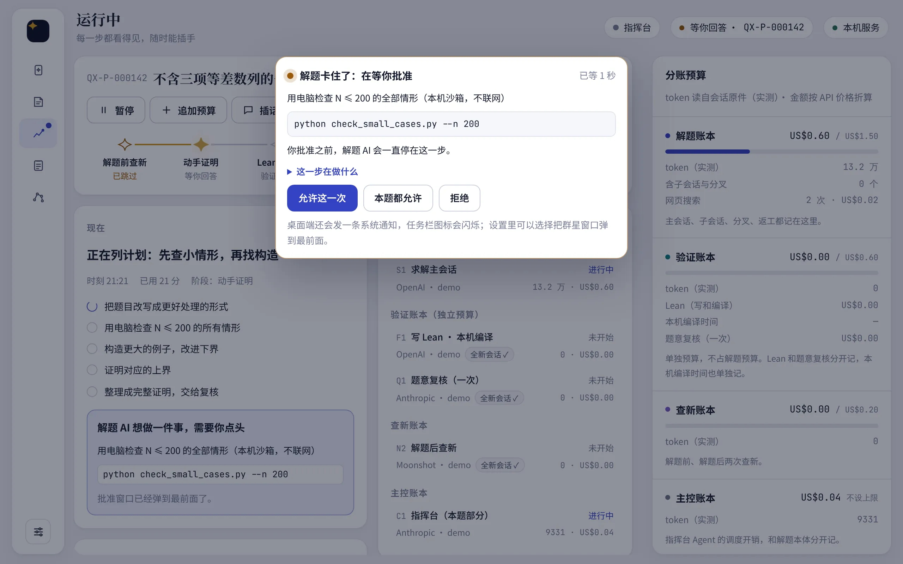
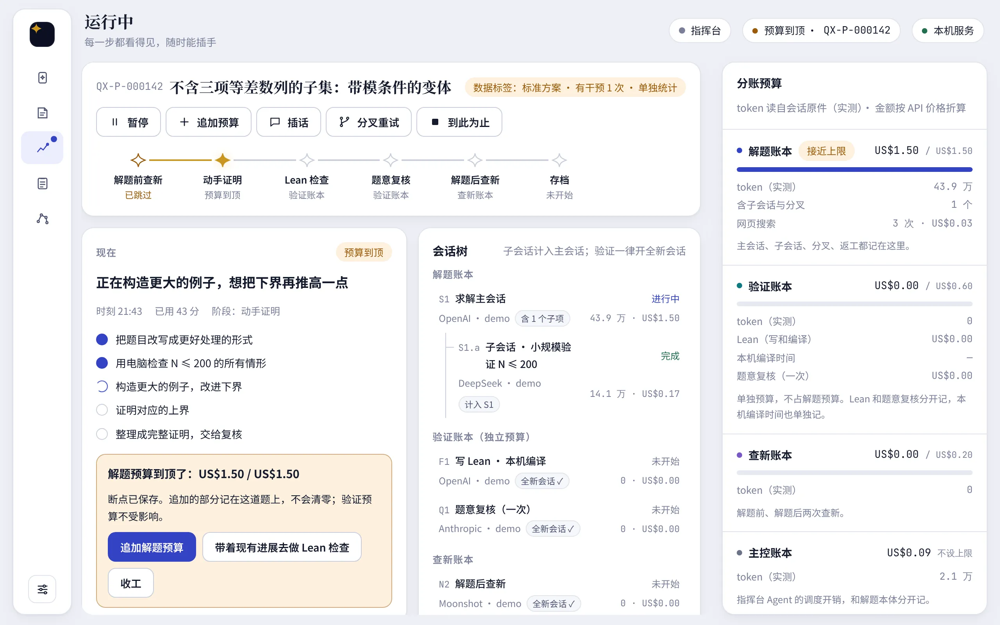
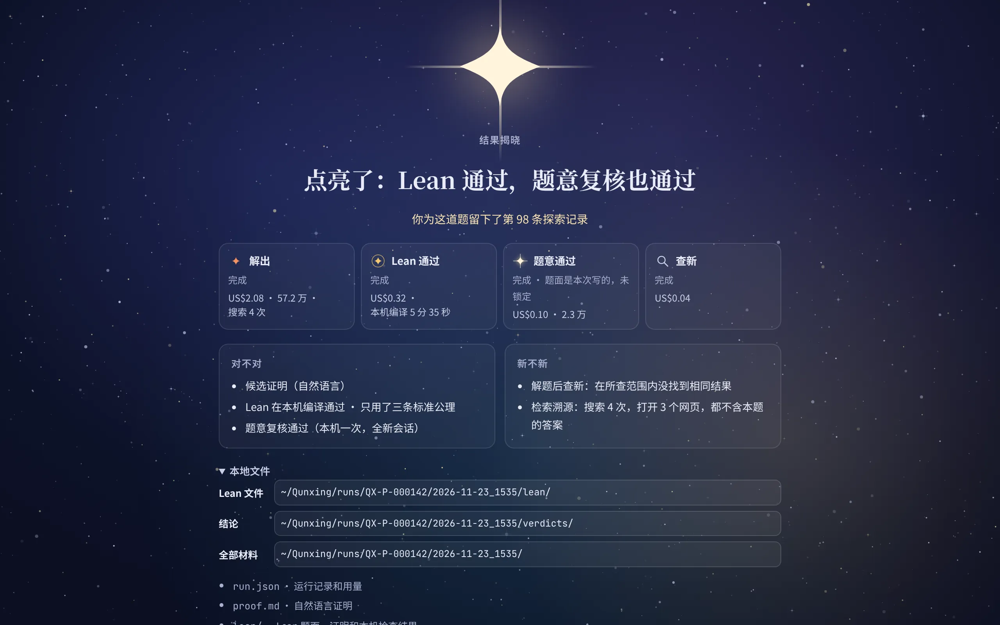
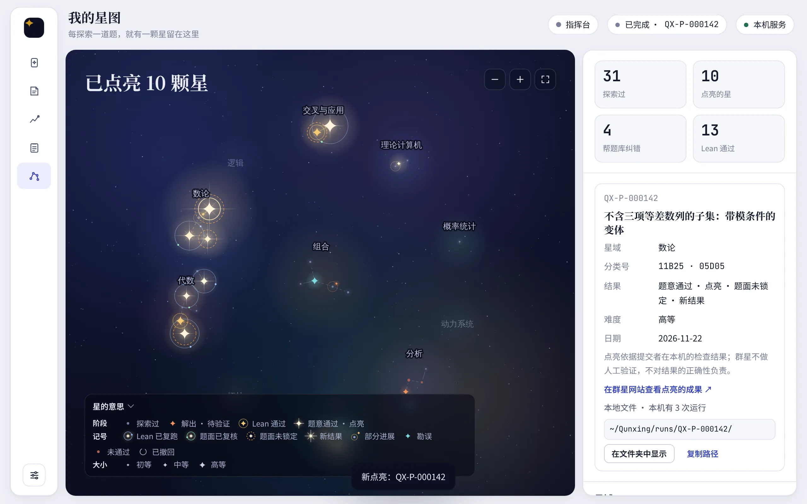

[目录](README.md) · **跑第一道题** · [English](../en/first-problem.md)

# 跑第一道题

一道题从抽到点亮，要经过五个页面：抽题 → 开题 → 运行中 → 结果 → 星图。

## 1. 抽题

先在左边选条件。同一组里一个都不选，就是不限。

| 条件 | 可选 |
|---|---|
| 轨道 | **开放问题**：还没人解决的题。解出来就是新成果，所以开题前要先查新。 **验证**：已经有人解决的题。用 Lean 把已知的证明形式化，确认它是对的。 **自解题**：你自己带来的题。以后的版本开放。 |
| 星域 | 组合、数论、几何、分析、代数、概率统计、理论计算机、拓扑、动力系统、逻辑、交叉应用 |
| 题型 | 证明、构造、求界、计算 |
| 难度 | **初等**：有限计算、特殊情形或小推广，适合第一次上手。 **中等**：研究级开放问题，通常已有部分进展。 **高等**：提出 20 年以上仍未解决的著名难题。 |

- 下面会显示 **符合条件 N 道**。
- 点 **抽一道题**，或者点右边的星门。

翻开的牌上有题号、星域、题型和题面。
- 不想做这道：点 **换一张**。
- 就做这道：点 **就它了**。

**第一次建议选"初等"**：花得少，跑得快，容易看全整个流程。

## 2. 开题

### 题卡

**中间是这道题的资料**：
- 非形式化状态、形式化状态；
- 可检验性、难度估计；
- **AI 题库与成果库核对**：这道题在几个公开题库和 AI 成果库里有没有收录、有没有已知证明。

### 查新

"开放问题"的状态可能已经过时：最近 AI 证明的新结果很多。

**状态旧了，群星会提醒你**，例如：
- 状态来自好几天前的查新；
- 题卡改过版本；
- 还没有查新记录。

**两个选择**：
- **一键查新**：按钮上写着预计花费和时间。
  - 查新是运行的第一步，查完再解题。
  - 查新单独记账，不占解题预算。
- **跳过，直接开始**：要先勾一句确认，再点 **确认，直接开始**。
  - 确认的意思是：如果这道题其实已被解决，花费和结论由你自己负责。
  - 群星会记下你跳过了查新。

### 分工和预算

**右边是这次的分工和预算**：
- **分工**：谁解题、谁复核。在新手引导的"谁来解题"一步分配；点 **改角色分配** 可以回去改。
- **解题预算**：到顶自动暂停，可以随时追加。
- **验证预算**：单独记账，不占解题预算。

**这一版按标准方案跑**：
- Lean 检查和题意复核都做；
- 网页搜索开着；
- 换模型卡、插策略卡，要等下一版。

最后点 **直接跑 · 标准方案**。

**题库太旧时**，开题前也会提醒你更新：
- 可以先点 **更新题库**；
- 也可以点 **仍然开题**。

## 3. 运行中

### 上面：这道题走到哪了

**阶段路径**：解题前查新 → 动手证明 → Lean 检查 → 题意复核 → 解题后查新 → 存档。

**题目旁边的数据标签**，例如"标准方案 · 有干预 1 次 · 单独统计"。
- 你插手过的运行会标出来，统计时和没插手的分开。

### 微操按钮

| 按钮 | 做什么 |
|---|---|
| **暂停** / **继续** | 停下或接着跑 |
| **追加预算** | 给解题或验证加钱。追加的记在这道题上，不会清零；这次运行会标成"预算已调整 · 有干预" |
| **插话** | 给解题 AI 一句提示，例如"试试按模 3 的余数分类"。 这次结果会标成"有人工提示"，统计时单独分层。 复核 AI 看不到你的提示 |
| **分叉重试** | 主线继续跑；从当前断点复制一路出来，换个思路试 |
| **到此为止** | 已经完成的阶段都会保留，之后还能从这一步接着做；这次会记为"你主动停下" |

### 中间："现在"、会话树、事件记录

- **现在**：AI 此刻在做什么，以及它列的计划，每做完一项打一个勾。
- **会话树**：主会话、子会话和分叉。
  - 子会话的用量算进主会话；
  - Lean 检查、题意复核都开全新的会话，看不到解题过程。
- **事件记录**：每一步都记下来，只追加，不修改。你的操作会标成"干预"。

### 右边：分账预算

**花费分四本账记**：

| 账本 | 记什么 |
|---|---|
| 解题 | 主会话、子会话、分叉、网页搜索 |
| 验证 | 写 Lean、本机编译、题意复核 |
| 查新 | 解题前和解题后的两次查新 |
| 主控 | 指挥台 Agent 的调度开销 |

**token 数旁边会写它是怎么来的**：
- **实测**：读 Agent 自己的日志；
- **Agent 自报**：没核对；
- **估算**。

**金额按 API 价格折算**。用订阅的话，不另外花钱，这个金额是参考值。

### AI 要做事时，先问你

**解题 AI 要跑程序、写文件时，会弹出一个在最前面的小窗口**。窗口上写着它想做什么、为什么。

三个按钮：
- **允许这一次**；
- **本题都允许**；
- **拒绝**。

**等你回答时**：
- 解题 AI 停在这一步，不计时间；
- 你的选择会记进事件记录。

**群星不在前台时**：
- 会发系统通知，任务栏图标会闪；
- 想让群星窗口直接弹到最前面：设置 → **需要我批准时，把群星窗口弹到最前面**。

**AI 多久问你一次**，在设置的 **运行方式** 里改：
- **一键全自动**；
- **关键处问我**；
- **每步都问我**。

### 预算到顶

解题预算用完时，运行会停下来，断点已经保存。三个选择：
- **追加解题预算**：拖动或输入金额，接着跑。
- **带着现有进展去做 Lean 检查**：不再解题，把已有的部分交去检查。
- **收工**：到此结束，推导和失败路径都存档。

**订阅额度用完时**，群星会等到额度恢复的时间，自动继续。等待的时间不算进耗时。

## 4. 结果

跑完会出现结果页。

**最上面一行写这次走到了哪一步**，例如：
- 这次没有得出可以核对的结果，推导和失败路径都存好了；
- 解出一份候选证明，还没验证；
- Lean 通过了，题意还没复核；
- **点亮了：Lean 通过，题意复核也通过**。

**四个格子**：解出、Lean 通过、题意通过、查新。
- 每格写着状态：完成、停在这一步、没做；
- 每格写着花费；
- 查新那格还写着搜索次数。

**对不对**：
- 候选证明（自然语言）；
- Lean 有没有在本机编译通过，是不是只用了三条标准公理；
- 题意复核有没有通过。

**新不新**：
- 解题后查新的结论；
- 检索溯源：搜索了几次、打开了几个网页、里面有没有本题的答案。
  - 打开过含答案的来源，这次成功会记为"检索所得"。

**本地文件**：Lean 文件、结论和全部材料各在哪个文件夹。
- 点 **在文件夹中显示** 直接打开。

**下面的按钮**：
- **再抽一道**；
- **去星图看看**；
- **继续**：你中途收工的，可以从停下的那一步接着做。

**结果页上还有两个上传按钮**：**上传科研数据**、**提交证明，点亮星星**。
- 这一版还不能上传：点了会提示"还没接上，下一版就有"，什么也不会发出去。
- 开放以后怎么用，见[隐私与上传](privacy-and-uploads.md)。

**点亮依据的是你本机的检查结果**。群星不做人工验证，也不为结果担责。

## 5. 星图

每探索一道题，星图上就留下一颗星。
- 拖动平移，滚轮缩放，双击看全图。
- 左下角 **星的意思** 是图例。

**星的阶段**：

| 阶段 | 意思 |
|---|---|
| 探索过 | 跑过，还没有可以核对的结果 |
| 解出 · 待验证 | Agent 交了证明，还没经过 Lean |
| Lean 通过 | Lean 在你电脑上编译通过，只用了标准公理；题面还没复核 |
| 题意通过 · 点亮 | Lean 通过，复核也确认 Lean 里的命题就是原题 |

**星上还可能有记号**：
- **Lean 已复跑**：群星在公开仓库的 CI 里重跑了 Lean，也通过了；
- **新结果**：点亮，且查新在所查范围内没找到已有结果；
- **题面已复核**：题卡的 Lean 题面已由维护者审核锁定；
- **题面未锁定**：Lean 证明的是本次自己写的题面，还没锁定，不计入网站的"已解决"数；
- **部分进展**：证明了特例、界或引理；
- **勘误**：题库标着未解决，但文献里已经解决了；
- **未通过**：Lean 或题意复核没通过，记录照样保留。

**点一颗星，右边显示详情**：
- 星域、分类号、结果、难度、日期；
- 本机文件；
- 在群星网站查看这道题的链接。

下一步：[Lean](lean.md)
