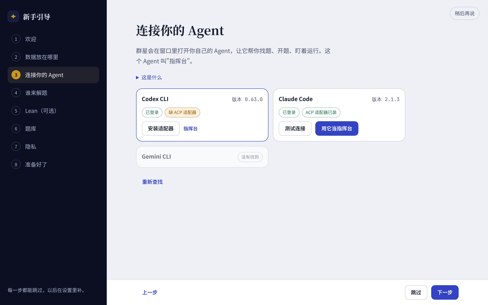

[目录](README.md) · **第一次打开** · [English](../en/first-run.md)

# 第一次打开：新手引导

第一次打开群星，会出现新手引导，一共八步。
- 每一步都能点 **跳过**，以后在设置里补。
- 想从头再来一遍：设置 → **重新进行新手引导**。

## 1. 欢迎

选语言（中文或 English）和主题。以后在设置里随时能改。

## 2. 数据放在哪里

题卡、运行记录、证明和 Lean 文件，都存在你电脑上的这个文件夹里。
- 默认是 `C:\Users\你的用户名\Qunxing`。
- 想换就点 **换一个文件夹**。以后在设置里也能改，已有的文件会一起搬过去。
- 默认什么都不上传。

## 3. 连接你的 Agent

群星会在电脑上查找已经装好的 AI 工具（这里叫 Agent）：Codex CLI、Claude Code、Gemini CLI。

**每张卡片上会写**：
- 版本号；
- 登录状态：**已登录** / **没有登录** / **登录状态未知**；
- 能不能接上：
  - **原生支持 ACP**：直接能用（Gemini CLI）；
  - **ACP 适配器已装**；
  - **缺 ACP 适配器**：Codex CLI 和 Claude Code 要一个小的转接程序。

**卡片上的按钮**：
- **安装适配器**：点了会先说明要下载什么、多大，你点 **确认安装** 才装。
  - 适配器从 npm 下载，装在群星自己的目录里，不改你的全局配置。
- **测试连接**：发一句很短的话，再关掉会话。
  - 用订阅只占一点额度；用 API 大约花 0.001 美元。
  - 成功会显示用了多少毫秒，以及计量有没有读到这次用量。
- **用它当指挥台**：指挥台是你自己的 Agent，开在群星窗口里，可以帮你找题、开题、盯着运行。
  - 它能调用群星的功能，但任何公开提交都要你亲手确认。

**一个都没找到？**
1. 先按官方说明装一个，并在终端里登录。找不到时，这一步会列出官方安装页的链接。
2. 回来点 **重新查找**。
3. 还是找不到，见[常见问题](faq.md#新手引导找不到我的-agent)。

不想现在连，点 **我先自己逛逛**。

## 4. 谁来解题

给每个环节选用哪个 Agent：

| 环节 | 做什么 |
|---|---|
| 解题 | 动手证明 |
| 写 Lean | 把证明写成 Lean，在你电脑上编译检查 |
| 题意复核 | 在全新会话里核对：Lean 里的命题是不是原题 |
| 查新 · 检索 | 查这道题是不是已经有人解决了 |
| 查新 · 核对 | 发现疑似结果时，打开原文核对、下结论 |

**两点建议**：
- **复核最好换一家**，这样更可信。只装了一家也能用：复核会开全新的会话。
- **每个环节都可以选订阅或 API**：
  - 订阅：用你的会员额度，不另外花钱；额度用完会等。
  - API：按用量付费，每一笔都记进账本。

点 **恢复标准方案** 可以回到默认分配。

这一步还要设 **每日花费上限**。
- 到了上限，就不再开新的运行；
- 正在跑的会停下来问你。

## 5. Lean（可选）

点 **检查**，看电脑上有没有 Lean。
- **有**：会显示 elan 和 Lean 的版本。
- **没有**：会列出安装步骤。也可以点 **稍后再装**。
  - 不装也能解题，但结果只能停在"解出"，到不了"Lean 通过"。
  - 详细说明见 [Lean](lean.md)。

## 6. 题库

**显示什么**：题库的日期和题数。

**建议点 现在更新**：题卡可能被修订过，题也可能已经被别人解决了。
- 下载后会先检查；检查不通过，保留旧版。

**以后有更新时**，三选一：
- **自动更新**；
- **先问我**（默认）；
- **不接收**。

**只在本机运行**：打开后不收更新、不上传。但调用 AI 仍然要联网。

## 7. 隐私

默认什么都不上传。想分享结果时，群星会分两步，每步单独问你：

| 哪一步 | 交什么 | 公开吗 |
|---|---|---|
| 提交证明，点亮星星 | 只交证明材料 | 公开；要用 GitHub 授权关联账号 |
| 上传科研数据 | 只有用量和费用 | 匿名；不含证明、对话原文和提示词 |

两步都可以跳过，也可以随时在设置里关掉。细节见[隐私与上传](privacy-and-uploads.md)。

## 8. 准备好了

这里列出每一项的准备情况：
- 状态分为：**就绪**、**建议处理**、**待办**、**未安装**、**出错**；
- 没做完的，以后在设置里随时补。

最后二选一：
- **看一次演示运行（不花钱）**：用演示数据把完整流程走一遍。Agent 是脚本，Lean 和金额都是模拟的。
- **直接抽一道题**：见[跑第一道题](first-problem.md)。

## 窗口右上角的几个小标记

- **指挥台**：点开和你的 Agent 对话。
- **状态**：待命、工作中、已暂停、等你回答、预算到顶、已完成。
- **本机服务**：群星的界面和后台连着。
  - 显示 **正在重连…**：后台的推送断了，会自动重连，连上后补上漏掉的事件。
  - 显示 **连接已失效**：关掉窗口，重新打开群星。

下一步：[跑第一道题](first-problem.md)
