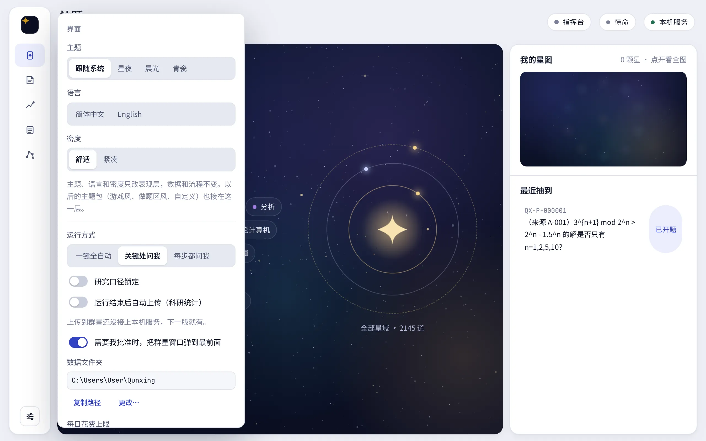

[目录](README.md) · **隐私与上传** · [English](../en/privacy-and-uploads.md)

# 隐私与上传

## 默认什么都不上传

运行记录、证明、Lean 文件和花费，都存在你电脑上的数据文件夹里。见[卸载与数据位置](uninstall.md)。

**群星不收集**：
- 对话原文、提示词；
- 你电脑上的文件和路径；
- 账号和 API 密钥。

**没有统计，也没有崩溃自动上报。**

## 什么时候会联网

| 什么事 | 什么时候 | 发出去什么 | 怎么关 |
|---|---|---|---|
| 看题库有没有更新 | 启动时一次，之后最多 6 小时一次 | 只问 GitHub 上题库的最新版本号，不下载、不带你的数据 | 设置 → 更新与联网 → 不接收；或者打开"只在本地运行" |
| 看软件有没有新版本 | 和上面一起 | 只问有没有新版本 | 同上 |
| 下载更新 | 默认先问你，你同意才下载 | 只下载 | 同上 |
| 调用 AI | 你开跑以后 | 题目、提示词，以及 AI 在本题文件夹里读到的内容。由**你自己的** AI 工具发给它的服务商 | 不开跑就不发 |
| 查新 | 开跑的第一步，可以跳过 | 检索词，也由你的 AI 工具发出 | 开题时选"跳过，直接开始" |
| 上传结果 | 只在你点了以后 | 见下面"上传" | 不点就不传 |

**两点说明**：
- 联网时，对方都能看到你的 IP 地址。
- AI 服务商怎么处理你的数据，按你和服务商之间的约定。群星管不到，也看不到。

## 只在本地运行

设置 → **更新与联网** → 打开 **只在本地运行（不连接群星的服务器）**。打开后：
- 不收更新，不上传；
- 题库停在当前版本，开题前会提醒你"题库不会更新"；
- 解题照常用你自己的 AI 账号，所以 AI 那部分仍然要联网。

## 上传

> **这一版还不能上传。** 结果页上的上传按钮点了只会提示"还没接上，下一版就有"，什么也不会发出去。下面是开放以后的做法。

上传分两步，每一步都单独问你，都可以跳过。

### 第一步：提交证明，点亮星星

- **交什么**：这次达到的阶段的证明材料：
  - 自然语言证明；
  - Lean 工程；
  - 本机检查的参数：工具链和 Mathlib 版本、文件哈希、用到的公理；
  - 题意复核的记录。
- **公开吗**：公开。Lean 代码按 Apache-2.0、文字按 CC BY-SA 4.0 授权。公开后只能撤回，不能删除。
- **不交什么**：用量和费用，那是第二步；也不含对话原文。
- **要什么**：一个群星账号，用 GitHub 授权关联。
  - 在浏览器里打开 github.com/login/device，输入群星给你的码。
  - 群星只读取你的 GitHub 用户编号，不要任何仓库权限。
  - 账号只用来担责和撤回，不公开。
- **交到哪**：群星公开数据集，或者你自己的 GitHub 仓库，也可以两处都交。
  - 交到自己的仓库，要在 GitHub 上把群星装到你选的那一个仓库上。群星只能写这一个仓库。
- **交了以后**：群星会在公开仓库的 CI 里重跑 Lean。通过后，星上加"Lean 已复跑"的记号。

### 第二步：上传科研数据

只有用量和费用，匿名。用来研究"AI 解数学题要花多少算力、效果怎样"。

**会上传**：
- 用量：每个环节的 token 数、用时，以及按 API 价格折算的花费；
- 运行方式：
  - 用了哪些模型和工具版本、各本账的预算上限；
  - 网页搜索的次数；
  - 做过哪几类干预（只记类型和次数）；
- 结果：
  - 题目编号、停在哪一步；
  - 你自己报的"对不对""新不新"；
  - 检索溯源的统计；
- 安装 ID（本机随机生成，可以在设置里重置）、运行时间（精确到分钟）、通道（订阅或 API）。

**不会上传**：
- 证明本身（证明在第一步单独提交）；
- 对话原文、提示词；
- 你电脑上的文件和路径、机器信息；
- 账号和 API 密钥。

**三个选项**：**仅这一次**、**以后都自动上传**、**暂不上传**。
- 选了"以后都自动上传"，每次上传后仍有一条提示。
- 自动上传随时可以在设置里关掉。
- 自动上传只传用量，不会替你提交证明。

**我们的承诺**：
- 只用于科研统计，不用于广告，也不出售。
- 公开的数据延迟两周发布，时间只精确到周；条数太少的组合并后再公开。
- 你可以随时关闭上传，或者申请删除。
- 上传内容一有变化，就重新征求你的同意。

## 存在哪里，谁会收到

上传的数据存在美国：
- **ZTNV Limited（VPS.Taxi）**：提供群星在美国洛杉矶的服务器。网站访问日志、你上传的数据和账号关联，都存在这台服务器上。
- **GitHub**：GitHub 登录；存放公开的证明、匿名化以后公开的数据，以及加密的私有研究快照。
- **Cloudflare**：域名解析和邮件转发。计划用它的 R2（美国辖区）存放加密的灾备文件，还没有启用。

**保存多久**：
- 科研原始记录保存到研究结束或满 3 年，以先到者为准。
- 删除以后，收件库里的记录立即删除，灾备里的副本 30 天内消失。

完整说明见网站的[隐私政策](https://www.qunxingmath.org/privacy/)。研究的规则见《群星研究守则》，会在网站上发布。

下一步：[常见问题](faq.md)
