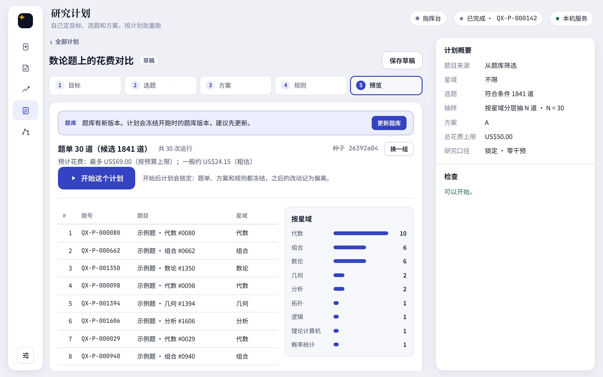

[目录](README.md) · **研究计划** · [English](../en/research-plans.md)

# 研究计划

研究计划用来一次跑一批题。比如你想知道：两种方案在数论题上，各花多少钱、成功率怎样。

左边栏点 **研究计划** 进入。

## 新建一个计划

点 **新建计划**，按五步填：

### 1. 目标

- **标题**：例如"数论题上的花费对比"。
- **目标**：你想通过这批运行知道什么。

### 2. 选题

**题目来源**，三选一：
- **从题库筛选**：
  - 按星域、轨道、难度、状态筛。某一类一个都不选，就是不限。
  - 可以只抽一部分，按星域分层抽样。
  - 抽样带随机种子，点 **换一组** 就能重抽。预览里的题单就是开跑后的题单。
- **导入的题号**：每行一个题号，或者用逗号隔开，例如 `QX-P-000142`。
- **两者都用**。

**顺序**：按列表、随机，或者 **按占比交错**。
- 按占比交错：无论跑到哪道题停下，已经跑完的部分在各星域之间都和题单成比例。

### 3. 方案

**一个方案就是一套跑法**：
- 用哪个 Agent 解题、哪个复核；
- 预算多少；
- 做不做题意复核。

**想比较两种跑法**，就点 **再加一套方案**。几套方案怎么分给题目，在 **分配** 里选：
- **每道题每套方案都跑（配对）**：比较最公平；
- **轮流分配**：花得少一些。

### 4. 规则

- **停止条件**，任一满足就停：
  - 总花费上限；
  - 截止日期；
  - 最多运行次数。
- **订阅额度用完时**：等额度恢复，或者停下。
- **并发**：一次一道题。这样计量更准。
- **锁定研究口径（零干预）**：
  - 锁定后，运行中不能追加预算、插话或分叉；
  - 权限请求由你选的权限策略自动答复；
  - 适合要拿来做对比的批次，每次运行的条件都一样。

### 5. 预览

预览会列出：
- 题单；
- 预计花费；
- 按星域的分布；
- 有没有问题要先处理。

没问题就点 **开始这个计划**。

## 开始以后

**开始以后，计划会锁定**：题单、方案和规则都冻结。
- 之后想改，要在 **偏离记录** 里写下改了什么、为什么改。
- 这样导出的结果能看出哪些运行是按原计划跑的。

**计划会冻结开跑时的题库版本**。
- 题库有新版本时，开始前会提醒你先更新。

**运行中**：
- 进度表显示每道题的状态：排队、运行中、完成；
- 可以 **暂停**、**继续**、**停止计划**；
  - 停止要再点一次确认。

## 导入和导出

**导入**：点 **导入**，有两种：
- 粘贴一份 `qunxing.plan/1` 格式的计划 JSON；
- 粘贴一列题号。

**导出**：
- **计划和结果（JSON）**；
- **逐次结果（CSV）**：可以直接用表格软件打开。

## 研究插件

研究插件能加额外的计量和导出。
- 插件不随公开版发布，只能在 **开发者模式** 下安装。
- 装之前会列出它要的权限。

下一步：[隐私与上传](privacy-and-uploads.md)
